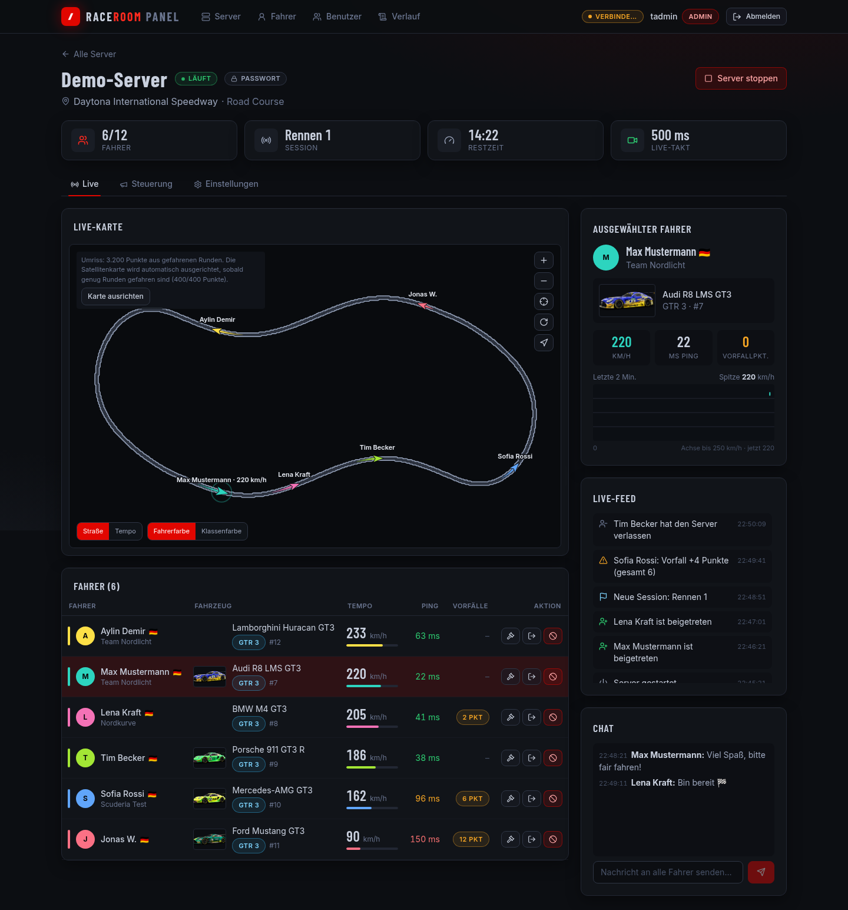
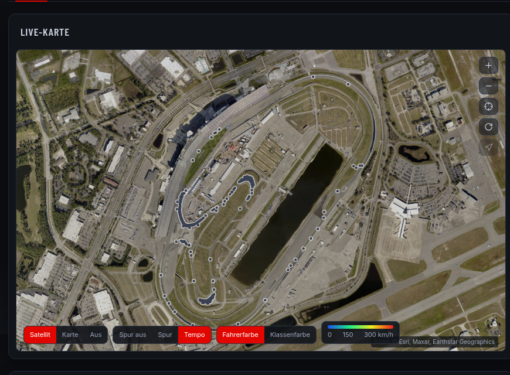

# RaceRoom Panel

Selbst gehostetes Web-Panel für den **RaceRoom Racing Experience Dedicated Server**: Server starten, stoppen und
komplett konfigurieren, Fahrer live auf einer Streckenkarte (bei echten Strecken auf dem Satellitenbild) verfolgen,
Chat, Strafen, Kick/Ban, Fahrer-Statistik, Rollen für Freunde.

*Self-hosted web panel for the RaceRoom Racing Experience dedicated server: control and configure servers, follow
drivers live on a (satellite) track map, chat, penalties, driver statistics, role-based access for friends.
UI language: German.*

> Inoffizielles Hobbyprojekt, nicht mit KW Studios / Sector3 Studios verbunden. „RaceRoom" ist eine Marke der jeweiligen Rechteinhaber.





## Funktionen
- **Server:** anlegen, starten, stoppen, löschen; Editor für Strecke/Layout, Fahrzeuge nach Klasse, Sessions (Zeit oder Runden, Tageszeit, Start), Regeln, Fahrhilfen (Presets wie im Original), Rating-Grenzen, Live-Takt, Server-Bild.
- **Live:** Fahrer mit Name/Avatar/Team (RaceRoom-Profil), Auto, Klasse, Livery-Bild, Tempo (aus Positionsänderungen berechnet), Ping, Vorfallpunkte; Karte mit Fahrtrichtung, Schweif, Folgen/Zoomen/Drehen; Live-Feed (Beitritte, Vorfälle, Session-Wechsel); Chat; Twitch-/YouTube-Stream einbetten.
- **Karte:** Der Streckenumriss wird aus den gefahrenen Positionen gelernt. Bei realen Strecken richtet das Panel die Spielkoordinaten automatisch an OpenStreetMap aus (Nominatim → `highway=raceway` → Verschiebungs-Fit) und zeigt Satellit (Esri) oder OSM als Untergrund.
- **Steuerung:** Session neu starten / weiter, Strafen (Slowdown, Drive-Through, Stop & Go, DQ), Kick, Ban, MOTD, Zuschauer-Whitelist.
- **Fahrer-Statistik:** Fahrzeit, Distanz, Top-/Ø-Tempo, Ping, Vorfälle, Fahrzeuge, Strecken, Besuche.
- **Sicherheit:** Login mit Rollen (Zuschauer/Host/Admin), scrypt, signierte HttpOnly-Cookies (Secure hinter HTTPS automatisch), Sitzungsende bei Passwortwechsel, Rate-Limit (X-Forwarded-For nur von vertrauten Proxys), CSRF-Header, CSP, Audit-Log.

## Wissenswertes über die Manager-API (selbst ermittelt)
- Der „RR Dedicated manager" (`RRRE_Dedicated.exe`, Steam-App 354060) läuft auf `http://localhost:8088` und akzeptiert **nur Host-Header `localhost`**. Das Panel setzt den Header selbst.
- `GET /dedi/` liefert die Server, aber **keine Fahrerliste**; die gibt es nur über `GET /dedi/{id}` (`Players`: `UserId`, `X`, `Z`, `CarLiveryId`, `Incidents`, `LatestPingMilliSec`).
- Anlegen/Ändern: `POST /dedi/` mit `{"GameSettings": …}` (mit `Id` = Ändern), Start/Stopp `POST /dedi/start|stop {"ProcessId"}`, Löschen `DELETE /dedi/{id}`.
- `StateReportInterval` (Standard 3000 ms) akzeptiert auch 500 ms → flüssige Live-Karte.
- `X`/`Z` sind **Ost/Nord-Meter** mit streckenspezifischem Nullpunkt (Daytona: Drehung 0,08°, keine Spiegelung).
- Server-Bild: Base64-PNG im Feld `Thumbnail`; der Manager lädt es selbst hoch und speichert danach eine https-URL.
- Registrierung (`POST /dedi/register {"Secret"}`) erwartet eine **selbst gewählte** Geheimphrase.
- Wine: Wine 11 scheitert (`mscoree.dll`), Wine 9 (32-Bit-Prefix + Mono) startet den Launcher, die Web-Oberfläche lauscht aber nicht → Windows empfohlen.

## Installation (Windows, gleicher Rechner wie der Dedicated Server)
```
cd deploy/windows
./fetch_deps.sh        # Python 3.13 embeddable (SHA-256-geprüft) + Wheels
./build_bundle.sh      # baut build/r3e-panel-win.zip
```
Paket auf den Windows-Rechner kopieren, entpacken und als Administrator `.\install.ps1` ausführen
(Details: [`deploy/windows/README.txt`](deploy/windows/README.txt)). Für Zugriff aus dem Internet einen Reverse Proxy mit HTTPS davorsetzen und dessen IP als `-TrustedProxies` angeben.

## Entwicklung
```
cd backend && python3 -m venv .venv && .venv/bin/pip install -r requirements.txt
MANAGER_URL=http://<manager-host>:8088 DATA_DIR=./data COOKIE_SECURE=0 STATIC_DIR=../frontend/dist \
  .venv/bin/uvicorn app.main:app --port 8123 --no-proxy-headers
.venv/bin/python -m app.cli add admin admin           # ersten Admin anlegen
cd ../frontend && npm install && npm run dev            # Vite mit Proxy auf :8123
```

## Experimentell: Zuschauer-Bot
RaceRoom-Client im offiziellen Zuschauer-Modus (`-broadcastUrl`) auf einer GPU ohne Monitor, als Datenquelle (Rangliste, Rundenzeiten) und ferngesteuerte Kamera mit NVENC-Stream. Stand und Anleitung: [`deploy/bot/README.md`](deploy/bot/README.md).

## Lizenz
MIT, siehe [LICENSE](LICENSE). Kartenkacheln: © Esri/Maxar/Earthstar Geographics bzw. © OpenStreetMap-Mitwirkende (deren Nutzungsbedingungen gelten).
